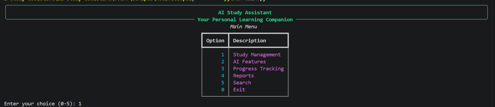
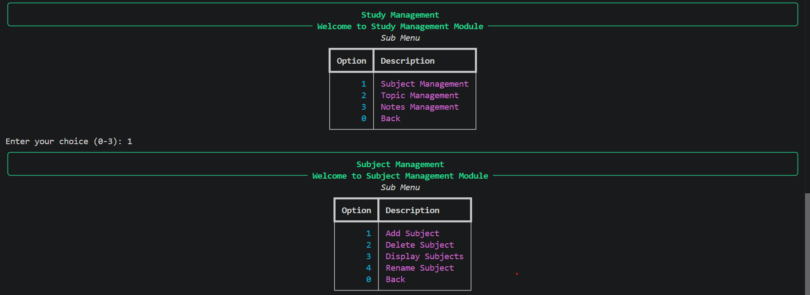
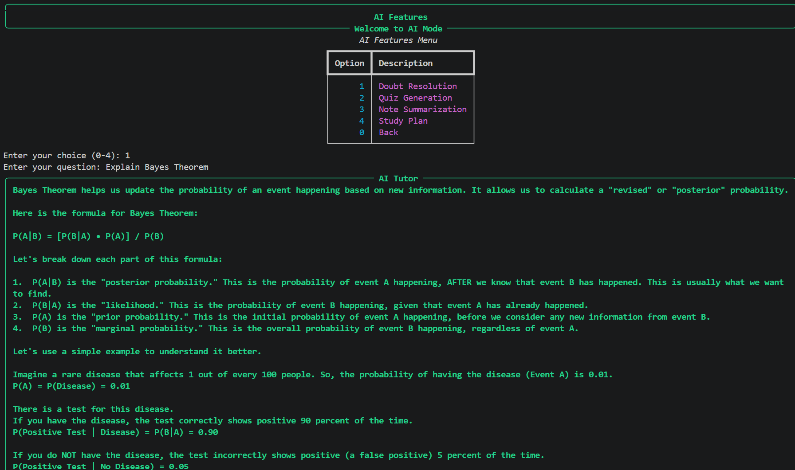
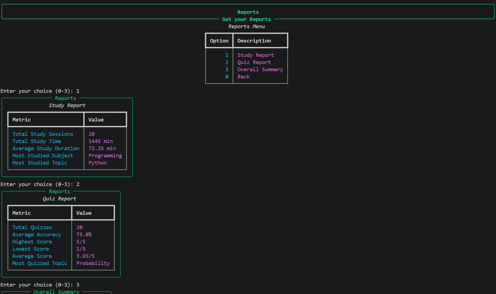
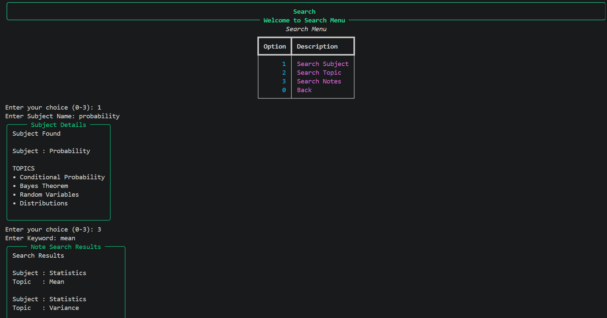

# AI Study Assistant

A modular AI-powered command-line application that helps students organize their studies, generate quizzes, summarize notes, track progress, and analyze learning using Python and the Google Gemini API.

## Project Description

**AI Study Assistant** is a command-line application built with Python to help students organize their studies, manage notes, generate AI-powered quizzes, summarize notes, create personalized study plans, track study sessions, analyze learning progress, and search study materials efficiently. The application uses the Google Gemini API to provide intelligent learning assistance while storing all study data locally using JSON files.

---

## Motivation

Managing study materials across multiple notebooks and applications can make learning disorganized and inefficient. Students often need to switch between note-taking apps, quiz platforms, timers, and planning tools to manage their studies.

The motivation behind this project was to create a single application that combines study management, AI-assisted learning, progress tracking, and analytics into one lightweight command-line tool. Additionally, this project provided an opportunity to apply the Python concepts learned throughout CS50P by designing and implementing a modular software application from scratch.

---

## Main Objective

The primary objective of **AI Study Assistant** is to provide students with a centralized learning companion that helps them study more effectively.

The application enables users to:

- Organize subjects, topics, and study notes.
- Generate AI-powered explanations for study-related questions.
- Create multiple-choice quizzes for self-assessment.
- Summarize lengthy notes into concise study material.
- Generate personalized study plans based on learning goals.
- Track study sessions and maintain study history.
- Analyze learning progress through reports and statistics.
- Search subjects, topics, and notes quickly using keywords.

By integrating these features into a single CLI application, the project aims to improve study organization, encourage consistent learning habits, and demonstrate practical software engineering principles such as modular programming, persistent data storage, API integration, and user-friendly interface design.

## Features

The application is organized into five major modules, each responsible for a specific aspect of the study workflow.

### 📚 Study Management

Manage study materials in an organized hierarchy of subjects, topics, and notes.

- Add, rename, delete, and view subjects.
- Add, rename, delete, and view topics under each subject.
- Create, edit, view, and delete notes for individual topics.
- Store all study data locally using JSON.

---

### 🤖 AI Features

Leverage the Google Gemini API to assist with learning.

- **Doubt Resolution** – Get AI-generated explanations for study-related questions.
- **Quiz Generation** – Generate multiple-choice quizzes for any study topic.
- **Note Summarization** – Convert lengthy notes into concise summaries.
- **Study Plan Generation** – Create personalized study plans based on learning goals, study duration, and daily study hours.

---

### ⏱️ Progress Tracking

Track study sessions to monitor learning consistency.

- Start and end study sessions.
- Automatically record:
  - Subject
  - Topic
  - Date
  - Start Time
  - End Time
  - Study Duration
- Store study history locally for future analysis.

---

### 📊 Reports & Analytics

Analyze learning progress using study and quiz history.

- **Study Report**
  - Total Study Sessions
  - Total Study Time
  - Average Study Duration
  - Most Studied Subject
  - Most Studied Topic

- **Quiz Report**
  - Total Quizzes Attempted
  - Average Accuracy
  - Highest Score
  - Lowest Score
  - Average Score
  - Most Quizzed Topic

- **Overall Summary**
  - Study Sessions
  - Total Study Time
  - Quizzes Attempted
  - Average Quiz Accuracy
  - Most Studied Subject
  - Most Quizzed Topic

---

### 🔍 Search

Quickly locate study materials.

- Search subjects by name.
- Search topics across all subjects.
- Search notes using keywords.
- Case-insensitive search for improved usability.

---

### 💾 Data Storage

- Local JSON-based data storage.
- Separate files for:
  - Subjects and Notes
  - Quiz History
  - Study History
- No external database required.

---

### 🖥️ User Interface

- Interactive command-line interface built using the **Rich** library.
- Menu-driven navigation.
- Colored output and formatted tables.
- User-friendly prompts and validation messages.

## Technologies Used

The project was developed using the following technologies and tools:

| Technology | Purpose |
|------------|---------|
| **Python 3** | Core programming language used to build the application. |
| **Google Gemini API** | Provides AI-powered features such as doubt resolution, quiz generation, note summarization, and study plan generation. |
| **Rich** | Creates an interactive and visually appealing command-line interface with panels, tables, colors, and formatted output. |
| **JSON** | Stores subjects, topics, notes, study history, and quiz history locally without requiring a database. |
| **python-dotenv** | Loads the Gemini API key securely from a `.env` file. |
| **Git** | Version control for tracking development and maintaining a clean commit history. |
| **GitHub** | Hosts the project repository and manages source code. |
| **Visual Studio Code** | Primary development environment used for writing, testing, and debugging the application. |

### Key Libraries

- **rich** – Interactive command-line interface
- **google-genai** – Google Gemini API integration
- **python-dotenv** – Environment variable management
- **json** – Local data persistence
- **datetime** – Study session tracking

## Project Structure

```text
ai-study-assistant/
│
├── data/
│   ├── subjects.json          # Stores subjects, topics, and notes
│   ├── quiz_history.json      # Stores quiz history and scores
│   └── study_history.json     # Stores study session history
│
├── aiManager.py               # AI feature management
├── geminiService.py           # Google Gemini API integration
├── progressManager.py         # Study session tracking
├── reports.py                 # Reports and analytics
├── search.py                  # Search functionality
├── storageManager.py          # JSON data management
├── studyManager.py            # Study management features
├── utils.py                   # Common utility functions
├── main.py                    # Application entry point
│
├── requirements.txt           # Project dependencies
├── LICENSE                    # MIT License
├── .env.example               # Example environment variables
├── .gitignore                 # Git ignored files
└── README.md                  # Project documentation
```

---

## Installation

Follow these steps to set up and run the project locally.

### 1. Clone the Repository

```bash
git clone https://github.com/<your-username>/ai-study-assistant.git
```

Replace `<your-username>` with your GitHub username.

---

### 2. Navigate to the Project Directory

```bash
cd ai-study-assistant
```

---

### 3. Create a Virtual Environment

**Windows**

```bash
python -m venv .venv
```

---

### 4. Activate the Virtual Environment

**Windows (PowerShell)**

```powershell
.venv\Scripts\Activate.ps1
```

**Windows (Command Prompt)**

```cmd
.venv\Scripts\activate
```

---

### 5. Install Dependencies

```bash
pip install -r requirements.txt
```

---

### 6. Configure the Gemini API Key

Create a `.env` file in the project root.

Add your Gemini API key:

```env
GEMINI_API_KEY=your_api_key_here
```

---

### 7. Run the Application

```bash
python main.py
```

The AI Study Assistant will start, displaying the main menu in the terminal.

---

## Requirements

- Python 3.10 or later
- Google Gemini API Key
- Internet connection (required only for AI-powered features)

## Usage

After launching the application, you will be presented with the main menu.

```text
AI Study Assistant

1. Study Management
2. AI Features
3. Progress Tracking
4. Reports
5. Search
0. Exit
```

A typical study workflow is shown below:

```text
Start Application
        │
        ▼
Choose Study Management
        │
        ▼
Create a Subject
        │
        ▼
Add Topics
        │
        ▼
Create or Edit Notes
        │
        ▼
Use AI Features
        │
        ├── Ask Study-Related Questions
        ├── Generate Quiz
        ├── Summarize Notes
        └── Generate Study Plan
        │
        ▼
Start a Study Session
        │
        ▼
Complete the Session
        │
        ▼
View Reports & Analytics
        │
        ▼
Search Subjects, Topics, or Notes
```

### Example Workflow

1. Launch the application.

   ```bash
   python main.py
   ```

2. Open **Study Management** and create a subject.

   Example:

   ```text
   Subject: Probability
   ```

3. Add topics under the subject.

   ```text
   Conditional Probability
   Bayes Theorem
   Random Variables
   ```

4. Add notes for each topic.

5. Use the **AI Features** module to:
   - Resolve study-related doubts.
   - Generate quizzes.
   - Summarize notes.
   - Create personalized study plans.

6. Start a study session using **Progress Tracking**.

7. After studying, view your learning statistics in the **Reports** module.

8. Use the **Search** module to quickly locate subjects, topics, or notes using keywords.

## Screenshots

### Main Menu



---

### Study Management



---

### AI Features



---

### Reports



---

### Search



---

## Future Improvements

This project represents **Version 1.0** of the AI Study Assistant. Several enhancements are planned for future versions.

### Version 1.1

- 📈 Visual analytics dashboard using Matplotlib.
- 📊 Charts for study time and quiz performance.
- 📅 Daily, weekly, and monthly study reports.
- 📁 Export reports to CSV and Excel.
- 🎯 Study streak tracking and goal completion.
- 🔖 Bookmark favorite subjects and topics.
- 📚 Flashcard generation using AI.
- 🔍 Advanced search with filters.

### Long-Term Improvements

- Replace JSON storage with SQLite.
- User authentication and multiple user profiles.
- Cloud synchronization of study data.
- Cross-platform desktop application.
- Mobile application.
- Support for multiple AI models.
- Personalized learning recommendations based on study history.

---

## License

This project is licensed under the **MIT License**.

You are free to use, modify, and distribute this project in accordance with the terms of the MIT License.

See the [LICENSE](LICENSE) file for more details.

---

## Acknowledgements

I would like to express my gratitude to the following resources and communities that made this project possible:

- **CS50P – Introduction to Programming with Python** by Harvard University for providing a strong foundation in Python programming and inspiring this final project.
- **Harvard University** for offering high-quality, accessible computer science education.
- **Google Gemini API** for enabling AI-powered features such as doubt resolution, quiz generation, note summarization, and study plan generation.
- **Rich** by Will McGugan for making it possible to build an interactive and visually appealing command-line interface.
- The **Python community** for maintaining an extensive ecosystem of open-source libraries and documentation.

---

## Author

**Vaibhav Mishra**

B.Tech Artificial Intelligence & Data Science Student

GitHub: https://github.com/vaibhav-mishra45

LinkedIn: https://www.linkedin.com/in/vaibhav-mishra-2001b53a0

---

---

## Final Note

AI Study Assistant was developed as the final project for **CS50P: Introduction to Programming with Python**. The project demonstrates the application of Python programming concepts, modular software design, JSON-based data management, API integration, and command-line interface development. Future versions will continue to expand the project with data visualization, advanced analytics, and additional AI-powered study tools.